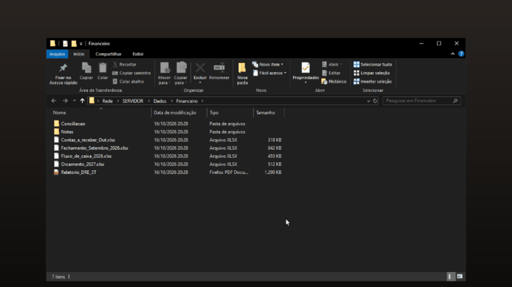

<p align="center"></p>

# recycle-net — Lixeira de rede

Lixeira para pastas compartilhadas (SMB) no Windows. Quando alguém apaga um arquivo
pela rede numa pasta protegida, o arquivo vai para a lixeira em vez de sumir, e dá
para ver quem apagou e restaurar.

Funciona como um serviço do Windows (`recycle-net`) junto com o minifilter
`netrbin.sys`, que já vem embutido no exe.

<p align="center"></p>

## Download

Baixe o `recycle-net-setup-X.Y.Z.exe` da última versão em
**[Releases](https://github.com/ittsjoao/recycle-net/releases)**.

Requisitos: Windows x64 e conta de administrador.

## Instalação

1. Rode `recycle-net-setup-X.Y.Z.exe`.
2. Escolha a pasta da lixeira.
3. Pronto: o driver e o serviço são instalados e iniciados.

Instalar por cima da versão antiga (rnetrbin 0.1.0) troca o serviço antigo pelo novo
e mantém a configuração e a lixeira.

## Uso

Abra o `recycle-net.exe` sem argumentos (pede UAC). A janela tem três abas:

- **Início**: arquivos apagados, quem apagou, restaurar ou excluir de vez.
- **Pastas protegidas**: quais pastas mandam o que for apagado para a lixeira
  (Incluir/Excluir).
- **Configurações**: serviço, iniciar com o Windows e tema.

Para saber **quem** apagou, o serviço liga a auditoria de exclusão do Windows ao
iniciar. Sem ela, o usuário aparece como "desconhecido".

Se uma GPO desligar a auditoria ou o serviço não conseguir ativá-la, ative à mão
(prompt como administrador):

```powershell
# Auditoria de sucesso em "Sistema de Arquivos"
auditpol /set /subcategory:"{0CCE921D-69AE-11D9-BED3-505054503030}" /success:enable

# SACL global: auditar DELETE (0x10000) em todos os arquivos
#   fora de domínio: Usuários (S-1-5-32-545)
auditpol /resourceSACL /set /type:File /success /user:"{S-1-5-32-545}" /access:0x10000
#   em domínio: Usuários do Domínio (troque pelo SID do seu domínio + -513)
auditpol /resourceSACL /set /type:File /success /user:"{S-1-5-21-xxxxxxxxxx-xxxxxxxxxx-xxxxxxxxxx-513}" /access:0x10000
```

Para conferir: `auditpol /get /subcategory:"{0CCE921D-69AE-11D9-BED3-505054503030}"` e
`auditpol /resourceSACL /type:File /view`. O SID do domínio aparece em
`whoami /user` (tudo antes do último `-`).

## Compilar

Requer Rust (toolchain MSVC).

```powershell
cargo build --release      # target\release\recycle-net.exe
cargo test
cargo clippy --all-targets
```

O build embute `driver/netrbin.sys` (ou o caminho em `RECYCLE_NET_DRIVER`) e o ícone
de `icons/`.

Instalador (requer [Inno Setup 6](https://jrsoftware.org/isinfo.php)):

```powershell
.\installer\build.ps1      # target\installer\recycle-net-setup-<versao>.exe
```
